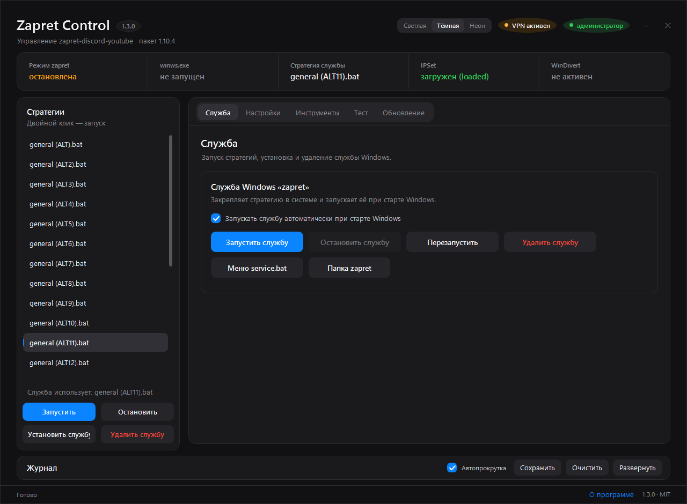

<!-- neon:header:start -->
<p align="center">
  
</p>
<!-- neon:header:end -->

<p align="center">
  <a href="https://github.com/Bugulmekas/zapret-gui/releases/latest">
    
  </a>
  <a href="https://github.com/Bugulmekas/zapret-gui/releases">
    
  </a>
  <a href="https://github.com/Bugulmekas/zapret-gui/actions/workflows/ci.yml">
    
  </a>
  <a href="LICENSE">
    
  </a>
  
  
</p>

<p align="center">
  
</p>

**Zapret Control** — графический управлятор для пакета [zapret-discord-youtube](https://github.com/Flowseal/zapret-discord-youtube) от **Flowseal**.

Переносит в удобное окно всё управление из `service.bat`: установку и удаление службы, стратегии, игровой фильтр, IPSet, диагностику, обновление списков. Добавляет запуск стратегий без службы, тест стратегий, предупреждение о конфликте с VPN и автообновление пакета и самого GUI прямо с GitHub.

- **GUI / форк:** Bugulmek
- **Пакет zapret и источник обновлений:** Flowseal
- **Интерфейс:** WPF + XAML, три темы: светлая, тёмная (по умолчанию) и «Неон»
- **Платформа:** Windows 10/11, PowerShell 5.1, .NET Framework 4.8 (входит в Windows)
- **Права:** требуются администратор (запрашиваются автоматически)

<p align="center">
  <a href="https://github.com/Bugulmekas/zapret-gui/releases/latest">
    
  </a>
</p>

---

## Возможности

| Раздел | Что умеет |
|---|---|
| **Стратегии** | Список всех `general*.bat`, запуск и остановка `winws.exe`, двойной клик — быстрый запуск |
| **Служба** | Установка, удаление, запуск, остановка и перезапуск, автозапуск при старте Windows, статус, режим работы и текущая стратегия |
| **Игровой фильтр** | Выключен / TCP и UDP / только TCP / только UDP, произвольные диапазоны портов |
| **IPSet** | Режимы `any` / `none` / `loaded`, резервная копия списка, обновление с GitHub |
| **Тест стратегий** | Запускает штатный `utils\test zapret.ps1` — тот же тест, что пункт 12 `service.bat` |
| **Диагностика** | BFE, прокси, Adguard, Killer, Intel Connectivity, Check Point, SmartByte, VPN и прокси-клиенты, DoH, WinDivert, конфликтующие службы |
| **Инструменты** | Обновление IPSet и `hosts`, очистка кэша Discord, замена active fake, удаление конфликтного WinDivert |
| **Обновление** | Проверка релизов через GitHub API, скачивание, распаковка в новую папку, перенос списков и переустановка службы; отдельно — самообновление GUI с GitHub |
| **Журнал** | Вывод `winws.exe` в реальном времени, сохранение и очистка лога |
| **Интерфейс** | Одно окно с сегментированной навигацией, статус-панель из 5 показателей, плашка «VPN активен», сворачиваемый журнал и три темы оформления |

## Установка

1. Скачайте последний архив со страницы **[Releases](https://github.com/Bugulmekas/zapret-gui/releases/latest)**.
2. Распакуйте его рядом с папкой zapret так, чтобы структура была такой:

```
F:\zapret\
├─ zapret-gui-1.3.0\              ← эта программа
│  ├─ ZapretControl.bat
│  ├─ ZapretControl.ps1
│  └─ ZapretCommon.ps1
└─ zapret-discord-youtube-1.10.x\
   ├─ service.bat
   ├─ bin\winws.exe
   └─ lists\ ...
```

3. Запустите **`ZapretControl.bat`** и разрешите запрос UAC.
4. Выберите стратегию слева и нажмите **«Запустить»** (без службы) или **«Установить службу»**.

Если папка zapret лежит в другом месте, укажите её через **«Инструменты» → «Выбрать папку zapret»**.

> Папка GUI может называться как угодно — программа сама находит `zapret-discord-youtube-*` рядом с собой.

## Скриншоты

<p align="center">
  
</p>

## Как это работает

### Интерфейс

Окно собрано на WPF: собственный XAML, стили и контролы, без сторонних библиотек. Слева — список стратегий и кнопки запуска, справа — пять разделов, переключаемых сегментированной навигацией: **Служба**, **Настройки**, **Инструменты**, **Тест**, **Обновление**. Сверху — пять ключевых показателей и переключатель тем, снизу — сворачиваемый журнал.

Темы: **светлая**, **тёмная** (по умолчанию) и **«Неон»** — тёмная палитра с градиентами и свечением в стиле GitHub-профиля Bugulmek. Тема переключается в шапке на лету и сохраняется в `data\config.json`; журнал и статусы перекрашиваются вместе с интерфейсом.

Состояние обновляется каждые две секунды: режим zapret, `winws.exe`, стратегия, IPSet и драйвер WinDivert.

Если запущен VPN или прокси-клиент (Happ, sing-box, xray, OpenVPN, WireGuard, Tailscale, NordVPN и другие), в шапке появляется оранжевая плашка **«VPN активен»**, а перед запуском GUI предупреждает: VPN и zapret вместе обычно отключают интернет.

### Запуск без службы

Кнопка **«Запустить»** читает строку `winws.exe` из выбранного `general*.bat`, подставляет `%BIN%`, `%LISTS%`, `%GameFilterTCP%` и `%GameFilterUDP%`, создаёт временный `data\run-current.bat` и запускает `winws.exe` скрыто. Вывод пишется в журнал.

### Служба Windows

Кнопка **«Установить службу»** создаёт службу `zapret` с аргументами выбранной стратегии и автозапуском — так же, как это делает `service.bat`. Текущая стратегия записывается в реестр и показывается в статусе.

Кнопки **«Запустить службу»** и **«Остановить службу»** управляют уже установленной службой без переустановки. Перед запуском удаляются осиротевшие `winws.exe` и служба драйвера WinDivert, а успехом считается только стабильная работа около пяти секунд — так служба не «считается запущенной», если `winws.exe` сразу упал.

### Обновление пакета

GUI проверяет последний релиз через GitHub API, скачивает zip-архив и распаковывает его **в новую папку рядом**:

```
F:\zapret\zapret-discord-youtube-1.10.4\
```

Пользовательские данные переносятся:

- `lists\list-general-user.txt`
- `lists\list-exclude-user.txt`
- `lists\ipset-exclude-user.txt`
- `lists\ipset-all.txt` и `.backup`
- `utils\game_filter.enabled`
- `utils\check_updates.enabled`

После обновления GUI переключается на новую папку и при необходимости переустанавливает службу. Старую папку можно удалить вручную.

### Обновление GUI

На странице «Обновление» есть отдельная карточка самообновления. GUI проверяет последний релиз `Bugulmekas/zapret-gui`, скачивает zip-архив, проверяет синтаксис скриптов и совпадение версии, делает резервную копию в `data\backup-<версия>` и заменяет `ZapretControl.ps1`, `ZapretCommon.ps1` и `ZapretControl.bat`. Настройки в `data\config.json` сохраняются, после установки приложение перезапускается само. Проверка обновлений GUI выполняется и при старте, если включена авто-проверка.

## Данные программы

Служебные файлы лежат в `data\` и не попадают в git:

| Файл | Назначение |
|---|---|
| `config.json` | папка zapret, выбранная стратегия, настройки |
| `winws.log` | вывод `winws.exe` при ручном запуске |
| `run-current.bat` | временный файл запуска |
| `ipset-new.txt` | временный файл обновления IPSet |

## Диагностика

```powershell
# Проверка без запуска окна: папка, версия, IPSet, игровой фильтр, стратегии, аргументы
powershell -NoProfile -ExecutionPolicy Bypass -File .\ZapretControl.ps1 -SelfTest

# Открыть окно на 5 секунд и закрыть (проверка сборки интерфейса)
powershell -NoProfile -ExecutionPolicy Bypass -File .\ZapretControl.ps1 -Preview -PreviewSeconds 5
```

## Частые проблемы

| Проблема | Решение |
|---|---|
| «Не удалось найти папку zapret» | Положите программу рядом с `zapret-discord-youtube-*` или укажите папку через «Инструменты» → «Выбрать папку zapret» |
| Интернет пропадает после запуска zapret | Выключите VPN или прокси-клиент: Happ, sing-box, xray, OpenVPN, WireGuard и подобные конфликтуют с zapret. В шапке при этом горит плашка «VPN активен» |
| `winws.exe` не запускается | «Инструменты» → «Диагностика», проверьте журнал. Частые причины: занят WinDivert, блокирует антивирус, повреждена папка `bin` |
| Служба не устанавливается | Запустите от имени администратора, проверьте `bin\winws.exe`, попробуйте «Меню service.bat» |
| Служба показывает «остановлена» | Если `winws.exe` завершили вручную (например, через диспетчер задач), служба остановится: это нормально. Запустите её кнопкой «Запустить службу» |
| После обновления не работает zapret | Убедитесь, что GUI переключился на новую папку, при необходимости переустановите службу |
| Тест стратегий не запускается | Удалите службу и остановите `winws.exe` — тест не работает одновременно со службой |
| Служба и ручной запуск конфликтуют | Это нормально: одновременно должен работать только один экземпляр zapret |

## Разработка

```
ZapretControl.ps1    основной скрипт: XAML-разметка, стили, страницы, вся логика
ZapretCommon.ps1     общие функции: стратегии, служба, IPSet, GitHub
ZapretControl.bat    запуск с самозапросом UAC
docs\                скриншоты
assets\              неоновые баннер и футер для README
```

Интерфейс — WPF (`PresentationFramework`), поэтому запуск идёт через `powershell.exe -Sta`. Стили лежат в `Window.Resources`, страницы — обычные `StackPanel`, видимость переключается обработчиками навигации. Диалоги свои, в том же стиле, вместо `MessageBox`.

Файлы `.ps1` должны быть в **UTF-8 с BOM** — иначе PowerShell 5.1 прочитает русский текст как ANSI.

Проверка синтаксиса и обязательных файлов выполняется в CI (`.github/workflows/ci.yml`) на каждый push и pull request.

## Благодарности

- **[Flowseal](https://github.com/Flowseal/zapret-discord-youtube)** — пакет zapret-discord-youtube и скрипты управления. Проект собрал более 36 000 звёзд на GitHub.
- **Bugulmek** — графический интерфейс и автообновление.

Проект не связан с разработчиками zapret и Discord. Используйте на свой риск.

## Лицензия

[MIT](LICENSE) © 2026 Bugulmek

Пакет zapret-discord-youtube не входит в репозиторий и распространяется отдельно — подробности в [NOTICE.md](NOTICE.md).

<p align="center">
  Если программа оказалась полезной — поставьте ⭐ репозиторию.
</p>
<!-- neon:footer:start -->
<p align="center">
  
</p>
<!-- neon:footer:end -->